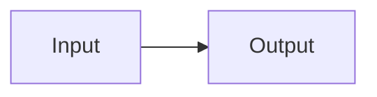
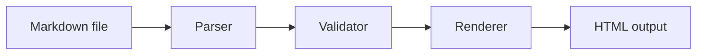
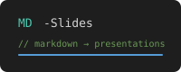

# Presenting with MD-Slides

## The complete feature reference

**Tutorial · feature test · live demo**

<!-- Speaker notes: This tour covers every feature in MD-Slides: all six templates, every content type, keyboard navigation, speaker view, CLI commands, themes, configuration, and validation. Two-column slides show the markdown you type on the left and what it renders on the right. Open examples/feature-tour.md alongside this presentation to see exactly what produced each slide. -->

---
template: content
---

## How to read this tour

Every feature is demonstrated by **using it**. Two-column slides show the Markdown on the left and what it produces on the right.

**Try it** lines are things to do right now, on this deck. If one doesn't work, that's a bug: this deck is MD-Slides' tutorial *and* its acceptance test.

Slide separators (`---`) can't appear as bare lines inside code blocks, so the examples show slide bodies only. Open `feature-tour.md` for the full format.

Eight sections: Templates · Content · Speaker view · Navigation · Any screen · CLI · Themes · Validation

<!-- Speaker notes: The two-column convention is central to the tour. Left column shows what you type; right column shows only what that produces. Try-it lines turn the tour into a checklist: walk through them on a laptop and a phone before every release. The escaping note matters because the parser splits slides on --- before Markdown processing. -->

---
template: section-title
---

## Templates

Six slide types — each with named slots and enforced constraints

<!-- Speaker notes: Every slide declares its template in frontmatter. The template determines layout, available slots, and what constraints apply. The surrounding --- that opens and closes frontmatter is the same token that separates slides — there is no separate frontmatter fence syntax. -->

---
template: content
---

## title template

Three slots: H1 title (required, ≤ 2 lines), H2 subtitle (optional, ≤ 2 lines), `**Author**` (optional, ≤ 80 chars).

```markdown
# Main Title
## Optional subtitle
**Optional author**
```

`title` is the only template that uses H1. All other templates use H2. The first slide of this deck uses the `title` template.

<!-- Speaker notes: The title template is used once — for the opening slide. H1 is visually dominant; using it anywhere else would conflict with H2 headings on content slides. The author slot expects bold text rather than a heading. The first slide in any deck must be the title template. -->

---
template: content
---

## content template

The `content` template is the workhorse — most slides use it. Two slots:

```markdown
## Slide Heading

Body: markdown, lists, code blocks, images, tables.
```

Heading: required, ≤ 80 chars. Body: ≤ 12 lines and ≤ 150 words. Validation reports all violations together — you fix everything in one pass, not one at a time.

<!-- Speaker notes: The density limits exist to protect your audience. A slide that exceeds 12 lines typically needs to be split. The 150-word limit prevents walls of text. Both limits are checked together with all violations across all slides reported at once using Either[NonEmptyList[ValidationError], SlideDeck]. -->

---
template: two-column
---

## section-title and closing templates

Open chapters with `section-title`:

```
template: section-title

## Chapter Title

Subtitle text
```

Both parse like `content`. Themes assign each a distinct visual identity.

---column---

End the deck with `closing`:

```
template: closing

## Thank You

Questions welcome
```

Themes can apply full-bleed backgrounds to these templates automatically.

<!-- Speaker notes: The section-title and closing templates parse identically to content, but themes can give each a very different visual appearance — a full-bleed background image, a contrasting color, a large centered title. This is done via templateConfigurations in the theme JSON, not in the slide frontmatter. -->

---
template: content
---

## two-column template

Split a slide into two independent columns using the `---column---` delimiter:

```
template: two-column
## Heading
Left column content here.
---column---
Right column content here.
```

Each column: ≤ 10 lines, ≤ 75 words. The `---column---` delimiter must be on its own line. The next slide demonstrates a live `two-column` layout.

<!-- Speaker notes: Everything before ---column--- is the left column; everything after is the right column. This content slide safely shows ---column--- in a code block because the parser only splits on bare --- lines. The ---column--- delimiter is a content-level token processed after the slide is parsed. -->

---
template: two-column
---

## two-column in action: before and after

**Sequential — simple but slow:**

```scala
def processAll(items: List[Item]): Unit =
  items.foreach(item => process(item))
```

Each item processed one at a time. Fine for small lists; bottleneck at scale.

---column---

**Parallel — Cats Effect:**

```scala
def processAll(items: List[Item]): IO[Unit] =
  items.parTraverse(item => process(item))
```

`parTraverse` runs all items concurrently using the IO thread pool.

<!-- Speaker notes: This is a live two-column slide. The before/after comparison is the most common use case for two-column — sequential vs. parallel, bad vs. good, input vs. output. Both columns have code blocks, body text, and bold headings. -->

---
template: content
---

## diagram template

The `diagram` template renders Mermaid charts to SVG at build time — requires `mmdc` installed.

````
template: diagram
caption: Optional caption
## Slide heading

````

Flowcharts, sequence, class, Gantt, pie, ER, and state diagrams are supported. The next slide is a live `diagram` slide.

<!-- Speaker notes: mmdc (mermaid-cli) must be installed. During render, mmdc converts each mermaid block to an SVG embedded directly in the HTML output. No client-side Mermaid.js is needed. The 4-backtick outer fence above safely contains the inner 3-backtick mermaid fence — this is how to show nested fences in code examples. -->

---
template: diagram
caption: The MD-Slides render pipeline
---

## Mermaid diagram: live render



<!-- Speaker notes: This is a live diagram template slide. The flowchart was rendered server-side by mmdc during the render pass and is embedded as SVG. The caption below the diagram came from the caption: frontmatter key. Diagram colours follow the deck theme: dark text on light shapes for light themes, light on dark for dark themes. Custom style directives work too, but check their contrast. -->

---
template: content
---

## Frontmatter: complete key reference

Every slide opens with a frontmatter block between `---` markers. Supported keys:

| Key | Required | Description |
|-----|----------|-------------|
| `template:` | yes | Slide type: `title` `content` `section-title` `two-column` `diagram` `closing` |
| `header:` | no | Top bar text — tokens: `{{pageNumber}}` `{{totalPages}}` `{{timer}}` `{{title}}` `{{date}}` |
| `footer:` | no | Bottom bar text — same tokens as `header:` |
| `vertical-align:` | no | Content position: `top` `center` (default) `bottom` |
| `background:` | no | Per-slide background image path (overrides theme for this slide only) |
| `caption:` | no | Caption below diagram (`diagram` template only) |

<!-- Speaker notes: The frontmatter block is enclosed in two --- markers — the same --- that separates slides. The first --- is both the slide separator and the frontmatter open; the second --- closes the frontmatter. Keys are case-sensitive and appear one per line with no quotes around values. -->

---
template: section-title
---

## Content

Formatting, lists, code blocks, images, and tables

<!-- Speaker notes: This section demonstrates every content type. All standard CommonMark inline elements work in any template body or column. Block elements include code blocks with syntax highlighting, ordered and unordered lists with nesting, images by path or data URL, and markdown tables. -->

---
template: two-column
---

## Inline formatting: you write / you get

```markdown
**Bold** text
*Italic* text
`Inline code`
[Link text](https://github.com/TJMSolns/MD-Slides)
~~Strikethrough~~
```

---column---

**Bold** text
*Italic* text
`Inline code`
[Link text](https://github.com/TJMSolns/MD-Slides)
~~Strikethrough~~

<!-- Speaker notes: All standard CommonMark inline elements are supported. The same formatting works in title subtitles, content bodies, column content, and speaker notes. The right column is the literal rendered output of the left column's markdown — nothing added or changed. -->

---
template: two-column
---

## Lists: you write / you get

```markdown
- First item
- Second item
  - Nested level 2
    - Nested level 3

1. Ordered first
2. Ordered second
   - Mixed nesting
```

---column---

- First item
- Second item
  - Nested level 2
    - Nested level 3

1. Ordered first
2. Ordered second
   - Mixed nesting

<!-- Speaker notes: Lists support up to 3 levels of nesting. Ordered and unordered lists can be mixed at nested levels. The right column is the rendered output of the left column's markdown. -->

---
template: content
---

## Code blocks: syntax highlighting

Fenced code blocks with a language name get full syntax highlighting:

```scala
case class Slide(id: SlideId, template: Template, slots: Map[SlotName, SlotContent])

object SlideDeck:
  def validated(slides: List[Slide]): Either[NonEmptyList[ValidationError], SlideDeck] =
    Either.cond(
      slides.nonEmpty,
      SlideDeck(slides),
      NonEmptyList.one(ValidationError("Empty deck"))
    )
```

190+ languages via highlight.js. Specify the language immediately after the opening fence: ` ```scala `.

<!-- Speaker notes: This code block is the demonstration — you're looking at syntax-highlighted Scala 3. The language identifier after the opening fence selects the highlighter. highlight.js runs client-side and supports Scala, Java, Python, JavaScript, TypeScript, Bash, SQL, JSON, YAML, and 190+ others. Code blocks auto-scale to fit slide width. -->

---
template: two-column
---

## Code blocks: Python and Bash

```python
def contrast_ratio(fg, bg):
    l1 = luminance(fg)
    l2 = luminance(bg)
    brighter = max(l1, l2)
    darker   = min(l1, l2)
    return (brighter + 0.05) / (darker + 0.05)

# WCAG AA: 4.5:1 for normal text
assert contrast_ratio('#000','#fff') >= 4.5
```

---column---

```bash
# Download the JAR
curl -L https://github.com/TJMSolns/\
  MD-Slides/releases/latest/\
  download/md-slides.jar \
  -o md-slides.jar

# Render with dark theme
java -jar md-slides.jar \
  render my-talk --theme dark
```

<!-- Speaker notes: Any language supported by highlight.js works — just use the correct identifier after the opening fence. Python and Bash are shown here side by side because they appear frequently in presentations about tools and algorithms. Both columns are purely code — no added explanatory text. -->

---
template: content
---

## Long code listings

```scala
def spell(n: Int): String = n match
    case  0 => "zero"
    case  1 => "one"
    case  2 => "two"
    case  3 => "three"
    case  4 => "four"
    case  5 => "five"
    case  6 => "six"
    case  7 => "seven"
    case  8 => "eight"
    case  9 => "nine"
    case 10 => "ten"
    case 11 => "eleven"
    case 12 => "twelve"
    case 13 => "thirteen"
    case 14 => "fourteen"
    case 15 => "fifteen"
    case 16 => "sixteen"
    case 17 => "seventeen"
    case 18 => "eighteen"
    case 19 => "nineteen"
    case 20 => "twenty"
    case _  => n.toString
```

Code blocks over 20 lines shrink to fit, and don't count against the 12-line body limit.

<!-- Speaker notes: This block is deliberately long. MD-Slides scales the font of code blocks longer than 20 lines, and fit-to-slide makes sure the whole slide still fits the screen. -->

---
template: two-column
---

## Images: you write / you get

```markdown

```

Path is relative to the `.md` source file. MD-Slides copies images to the output directory automatically.

**Alt text is required** — missing alt text is a WCAG 2.1 validation error.

For self-contained files: ``

---column---


<!-- Speaker notes: Local images are copied to the output directory during render. Base64 data URLs are embedded inline — this feature-tour.md is fully self-contained because the logo uses a data URL. The right column shows only the rendered image — the exact output of the markdown on the left. Alt text is validated against WCAG 2.1. -->

---
template: two-column
---

## Tables: you write / you get

```markdown
| Template | Max body | Used for |
|----------|----------|----------|
| `title` | — | Opening slide |
| `content` | 12 ln / 150 w | **Most** slides |
| `two-column` | 10 ln / 75 w | Comparisons |
| `diagram` | — | Mermaid charts |
| `closing` | 12 ln / 150 w | Final slide |
```

Column alignment: `|:---:|` center · `|---:|` right. Bold, `code` and links work inside cells.

---column---

| Template | Max body | Used for |
|----------|----------|----------|
| `title` | — | Opening slide |
| `content` | 12 ln / 150 w | **Most** slides |
| `two-column` | 10 ln / 75 w | Comparisons |
| `diagram` | — | Mermaid charts |
| `closing` | 12 ln / 150 w | Final slide |

<!-- Speaker notes: Tables render as semantic HTML with thead and tbody. Inline code, bold, and links all work inside cells. Tables count against body density limits. The right column is the exact rendered output of the table markdown on the left — nothing added. -->

---
template: content
background: data:image/svg+xml;base64,PHN2ZyB4bWxucz0iaHR0cDovL3d3dy53My5vcmcvMjAwMC9zdmciIHdpZHRoPSI0MCIgaGVpZ2h0PSI0MCI+PHBhdGggZD0iTTAgNDBMNDAgMCIgc3Ryb2tlPSIjODg4IiBzdHJva2Utb3BhY2l0eT0iMC4yNSIgc3Ryb2tlLXdpZHRoPSIyIi8+PC9zdmc+
---

## Per-slide background image

The diagonal stripes behind this slide come from its frontmatter. In your own deck you'd write:

```
template: content
background: images/stripes.png
```

`background:` takes an image path (copied into the output) or a `data:` URL, as here, which keeps the tour a single file. It overrides the theme background for this slide only. PNG, JPEG, SVG and WebP all work.

<!-- Speaker notes: This slide's background is a small SVG pattern encoded as a data URL, so feature-tour.md works on its own. The pattern is translucent, so text keeps the theme's contrast in both light and dark themes; a solid dark image would make dark-theme-light text fine but break the light theme. Per-slide backgrounds override only this slide. -->

---
template: section-title
---

## Speaker View

Notes, next-slide preview, and elapsed timer

<!-- Speaker notes: Speaker view opens in a separate window synchronized to the main presentation via BroadcastChannel. The speaker window shows: current slide (small preview), next slide heading, speaker notes for the current slide, and an elapsed timer. Navigation in either window keeps both in sync. -->

---
template: two-column
---

## Speaker notes: you write / you get

```markdown
<!-- Speaker notes: Key point here.
Don't forget to mention Y.
Notes can span multiple lines. -->
```

Place the comment anywhere in the slide body. Press **S** to open speaker view.

---column---

**In speaker view, you see:**

- Current slide (small preview)
- Next slide heading
- Your notes for the current slide
- Elapsed timer

Notes are **never** visible in the main window.

<!-- Speaker notes: You found the speaker notes. This is what appears in speaker view — only you see this. The audience sees only the slide content. The left column shows the exact HTML comment syntax; the right column describes where notes appear. -->

---
template: content
---

## Speaker view: layout, sync and timer

The speaker window shows the slide counter with ‹ › buttons, the elapsed timer, your notes, and the next slide's heading. On a phone it becomes one column.

The two windows stay in step: move in either one and the other follows (same browser, same device).

Timer: **T** pauses or resumes, **R** resets. `{{timer}}` in a header or footer shows it on slides.

**Try it:** press **S**, then change slides in either window.

<!-- Speaker notes: Speaker view and the presentation synchronise through the browser's local storage events, so both windows must be in the same browser on the same device. Opening speaker.html on a phone will not follow a laptop. The timer starts on the first slide change, not on page load. Navigation keys, the buttons and swipes all work in speaker view; break mode, goto, history and timer keys belong to the main window. -->

---
template: section-title
---

## Navigation

Every keyboard shortcut

<!-- Speaker notes: MD-Slides provides a complete keyboard-driven navigation model. Arrow-key navigation, speaker view, break mode, direct-jump goto, browser-like history, and timer controls — all without touching the mouse. -->

---
template: content
---

## Keyboard shortcuts — complete reference

| Key | Action |
|-----|--------|
| `→` `↓` `Space` `Enter` `PgDn` | Next slide |
| `←` `↑` `PgUp` | Previous slide |
| `Home` / `End` | First / last slide |
| `F` / `S` | Fullscreen / speaker view |
| `B` / `L` | Break mode / save session log |
| `G` | Goto: type slide number, press Enter |
| `P` / `N` | History back / forward |
| `T` / `R` | Pause / reset timer |

Clickers just work. On a phone or tablet, swipe, tap, or use the ‹ › buttons.

<!-- Speaker notes: Arrow keys and Space are the primary navigation; clickers send Page Up/Down or arrows, so they work without setup. On touch screens, swipe or tap the right 70% (next) or left 30% (previous) of the screen. Speaker view handles the navigation keys; break mode, goto, history and timer keys work in the main window. S opens speaker view in a new window — position it on your laptop while projecting the main view. B hides slides from the audience. P and N provide browser-like history navigation ideal for Q&A sessions where you jump around non-linearly. -->

---
template: content
---

## Break mode, goto and history

**Break mode (B):** hides the slides and pauses the timer. Press B again to resume. Set a custom image with `--break-screen` or `breakScreen` in your config.

**Goto (G):** type a slide number and press Enter, or pick a slide from the list. On a touch screen, tap the slide counter.

**History (P / N):** back and forward through the slides you actually visited.

**Try it:** press **G**, type 3, press Enter, then press **P** to come back here.

<!-- Speaker notes: Break mode is for pauses and Q&A: the audience sees the break screen while your speaker view keeps your place. Goto pauses the timer while it is open. History follows your real path, so after a goto, P returns to where you were rather than to the previous numbered slide. Goto is disabled while break mode is on. -->

---
template: section-title
---

## Any screen

Laptop, projector, phone or tablet

<!-- Speaker notes: This section exercises mobile presenting and fit-to-slide. Walk through it on a phone before every release. -->

---
template: two-column
---

## Touch, clickers and fullscreen

**Touch screens:**
- Swipe left or right
- Tap the right side (next) or the left side (back)
- Use the ‹ › buttons by the counter

**Clickers** send Page Down / Page Up or arrow keys, so they just work.

---column---

**Fullscreen:** press **F** or the ⛶ button (hidden where the browser can't do it, as on iPhone).

**Try it:** swipe to the next slide, then come back with a tap on the left.

<!-- Speaker notes: Taps only navigate for touch and pen input, never for a mouse, so text selection on a laptop still works. Vertical drags, pinch-zoomed panning and scrolling a wide code block sideways do not change slides. On phones the layout respects the notch and uses the visible screen height so browser toolbars do not cut slides off. -->

---
template: content
---

## Fit to the screen: a deliberately wide slide

| Stage | Input | Parser | Validator | Renderer | Theme | Assets | Output |
|-------|-------|--------|-----------|----------|-------|--------|--------|
| 1 | `deck.md` | Flexmark | Structure | Scalatags | JSON | Images | `index.html` |
| 2 | Frontmatter | Slots | Density | Speaker view | Fonts | Diagrams | `speaker.html` |
| 3 | Notes | Templates | WCAG 2.1 AA | Navigation JS | Colours | Break image | Session log |

This table is wider than a phone screen. The slide shrinks to fit, and the table re-wraps rather than overflowing.

**Try it:** rotate your phone, or resize this window. The slide re-fits.

<!-- Speaker notes: Fit-to-slide first shrinks wide tables, diagrams, code and images to the available width, then scales the whole slide to the largest size that fits. If a slide would need to drop below 35 percent it scrolls instead, which usually means the slide has too much on it. -->

---
template: content
---

## Links to a slide

The address bar tracks the current slide as `#N`. Reloading keeps your place, and a link can open any slide:

```
https://www.tjm.solutions/mdslides/demo/#12
```

Changing slides doesn't add browser history, so Back (or a phone's back gesture) leaves the deck rather than stepping through it. Use **P** and **N** for slide history.

**Try it:** look at the address bar, then reload. You stay on this slide.

<!-- Speaker notes: Deep links use history.replaceState, which updates the URL without adding history entries. This is what lets you send someone a link to the exact slide a question was about. -->

---
template: section-title
---

## CLI Commands

render, display, report, config, and smart default

<!-- Speaker notes: MD-Slides has four CLI usage patterns. render is the core command. display adds session logging. report analyzes past sessions. config shows the merged configuration. The smart default picks render or display automatically based on context. -->

---
template: two-column
---

## render: markdown to HTML

```bash
java -jar md-slides.jar render my-talk
java -jar md-slides.jar render my-talk \
  --theme dark
```

`my-talk`, `my-talk.md` and `talks/my-talk` all resolve. Errors (structure, missing alt text) stop the render; density limits only warn.

---column---

```
my-talk/
  index.html      ← presentation
  speaker.html    ← speaker view
  sync.js         ← plus 7 small
  …                 support scripts
  images/         ← copied assets
```

<!-- Speaker notes: render validates first and collects every problem in one pass. Structural errors and accessibility failures stop the render; density overruns are warnings, because sometimes a dense slide is the right call. The output folder is self-contained: open index.html from disk or host the folder anywhere. -->

---
template: content
---

## render: all flags

| Flag | Default | Purpose |
|------|---------|---------|
| `--theme NAME` | `light` | `light`, `dark`, `corporate`, or a theme folder in `./themes` |
| `--no-copy-images` | copy on | Skip copying image assets |
| `--skip-accessibility` | check on | Skip WCAG 2.1 AA validation |
| `--accessibility-report FILE` | off | Write validation results to JSON |
| `--break-screen IMAGE` | none | Image shown in break mode |
| `-i FILE` / `-o DIR` | — | Explicit input and output paths |

Custom themes are folders: `themes/mytheme/theme.json`, used as `--theme mytheme`.

<!-- Speaker notes: Themes are found by name in ./themes next to where you run the command, or in the folder set by paths.themesDir in your global config. Run with --help for the full list of commands and options. -->

---
template: content
---

## config command

```bash
java -jar md-slides.jar config
```
```
Global Configuration:
  Location: ~/.mdslides/config.json
  Settings:
    defaults.theme: light
Project Configuration:
  Location: .mdslides/config.json
  Settings:
    theme: dark
```

Shows which settings are in effect and which file each came from.

<!-- Speaker notes: Useful for diagnosing an unexpected theme or output folder. The real output also lists the priority order and the fields each file accepts. -->

---
template: two-column
---

## Session log: how did the talk go?

While presenting, MD-Slides records every slide change (and how it happened), timer pauses and breaks.

Press **L** to save the log. Your browser saves it as `my-talk-<date>-<time>.log.json`.

**Try it:** press **L** now.

---column---

```bash
java -jar md-slides.jar report my-talk
```

Report shows:
- Time per slide, breaks excluded
- The path you took
- Breaks, and how you navigated

It finds the newest log in Downloads, or use `--log FILE`.

<!-- Speaker notes: The log stays in the page until you press L, so nothing is sent anywhere. Save it at the end of a talk, or mid-way: a mid-way save is marked as such in the report. report looks in the deck folder, the current folder and ~/Downloads for the newest log for that deck. -->

---
template: content
---

## Smart default: no subcommand needed

```bash
java -jar md-slides.jar my-talk
```

1. If a saved session log exists, shows its report
2. Renders if `my-talk.md` changed since the last render
3. Opens the presentation in your browser

`display my-talk` just opens it; `render my-talk` just renders.

<!-- Speaker notes: The smart default is the rehearsal loop: run it, present, press L, run it again and you see how the last run went before the deck opens. -->

---
template: two-column
---

## MCP server: decks from an AI assistant

`mdslides-mcp.jar` (on the releases page) runs MD-Slides as a Model Context Protocol server over stdio.

```bash
java -jar mdslides-mcp.jar
```

---column---

| Tool | Does |
|------|------|
| `render_deck` | Render a deck |
| `validate_deck` | Check a deck |
| `list_themes` | List themes |
| `get_deck_info` | Count slides, templates, images |

<!-- Speaker notes: The MCP server is stateless and file-in, file-out: an assistant writes Markdown, calls render_deck, and gets the same output the CLI produces. Add it to your assistant's MCP configuration as a command that runs java -jar mdslides-mcp.jar. -->

---
template: two-column
---

## Distributing your presentation

The output directory is **self-contained**:

```bash
# Web server
scp -r my-talk/ user@server:/var/www/html/

# GitHub Pages
# Push my-talk/ to docs/ or gh-pages branch

# Email: zip the folder
zip -r my-talk.zip my-talk/
```

`index.html` opens in any browser — no server required.

---column---

**PDF export — browser print** (speaker notes stay out of the PDF):

1. Open `my-talk/index.html`
2. File → Print (Ctrl/Cmd + P)
3. Destination → Save as PDF, then Print

Or with headless Chrome:

```bash
chromium --headless \
  --print-to-pdf=my-talk.pdf \
  my-talk/index.html
```

<!-- Speaker notes: The output is deliberately self-contained — index.html, speaker.html, and all assets in one directory that works without a server. For GitHub Pages, put the output in a docs/ folder or gh-pages branch. PDF via browser print is simplest; headless Chrome gives more control over page size and margins. -->

---
template: two-column
---

## Fullscreen and browser tips

**Fullscreen:** **F**, the ⛶ button, or **F11** (Windows/Linux) / **Ctrl+Cmd+F** (Mac).

**Syntax highlighting** loads from a CDN, so code is highlighted when you're online. Everything else works offline.

---column---

**Opening speaker view:**

1. Press **S** in the presentation
2. Drag the new window to your laptop screen
3. Navigate from either window

**If speaker view won't open,** allow pop-ups for the page, or serve the folder:

```bash
python3 -m http.server 8080
```

<!-- Speaker notes: Some browsers block window.open for file:// pages; a local HTTP server avoids that. Both windows must be in the same browser. -->

---
template: section-title
---

## Themes and Configuration

Built-in themes, custom JSON themes, and four-layer config

<!-- Speaker notes: MD-Slides ships with two themes — light and dark. Custom themes are JSON files that override any visual property. Configuration is layered: CLI flags override project config, which overrides global config, which overrides built-in defaults. -->

---
template: content
---

## Built-in themes

```bash
java -jar md-slides.jar render my-talk --theme light  # default
java -jar md-slides.jar render my-talk --theme dark
```

**light** — white background, dark text. **dark** — dark background, light text, teal accents. **corporate** — a neutral business look.

All pass WCAG 2.1 AA contrast. This deck's live demo uses `dark`.

<!-- Speaker notes: Built-in themes need no files. Anything else is a theme folder, covered on the next slides. -->

---
template: content
---

## Theme backgrounds: colour and image

In `themes/mytheme/theme.json`:

```json
"background": { "color": "#1e1e1e", "image": "images/deck-bg.jpg" },
"templateBackgrounds": { "section-title": "images/section.png" }
```

Theme image paths are relative to the theme folder, and are copied into your output.

Priority: per-slide `background:` > `templateBackgrounds` > deck background.

<!-- Speaker notes: templateBackgrounds maps a template name to an image, so every section-title slide gets the same art without any per-slide frontmatter. -->

---
template: two-column
---

## Custom themes: a theme folder

```
themes/
  mytheme/
    theme.json
    images/
```

```bash
java -jar md-slides.jar render \
  my-talk --theme mytheme
```

---column---

`theme.json` needs every section: `name`, `version`, `background`, `colors`, `fonts`, `spacing`, `syntax`, `slideCounter`.

Copy a complete example from the docs' Themes page and change what you need.

<!-- Speaker notes: A theme with missing sections is rejected, so start from the full schema in the Themes documentation. Themes are looked up by name in ./themes, or in paths.themesDir from your global config. -->

---
template: two-column
---

## Per-template configuration in themes

```json
"templateConfig": {
  "section-title": {
    "header": "{{pageNumber}}/{{totalPages}}",
    "verticalAlign": "top"
  },
  "closing": {
    "footer": "{{title}} · {{date}}"
  }
}
```

---column---

| Key | Effect |
|-----|--------|
| `header` | Header text, with tokens |
| `footer` | Footer text, with tokens |
| `verticalAlign` | `top` `center` `bottom` |
| `colors` | Colour overrides |

Every slide of that template gets it, with no frontmatter needed.

<!-- Speaker notes: templateConfig is keyed by template name. Per-slide frontmatter still wins over it for a single slide. -->

---
template: content
header: Feature Tour — Slide {{pageNumber}} of {{totalPages}}
footer: {{title}} · {{date}} · {{timer}}
---

## Per-slide header and footer: live demo

This slide's frontmatter:

```
header: Feature Tour — Slide {{pageNumber}} of {{totalPages}}
footer: {{title}} · {{date}} · {{timer}}
```

Tokens: `{{pageNumber}}` `{{totalPages}}` `{{timer}}` `{{title}}` (the deck title) `{{date}}` (today).

**Try it:** check the header and footer on this slide. The timer ticks.

<!-- Speaker notes: Per-slide header and footer override the theme and config for this slide only. Set deck-wide ones with templateConfig in the theme, or header and footer in .mdslides/config.json. -->

---
template: content
---

## Vertical alignment

Content position per slide via frontmatter:

```
template: content
vertical-align: top
```

Three options: `top` · `center` (default) · `bottom`

Useful for sparse slides where centered text looks visually unbalanced, or for slides with code blocks that benefit from a predictable top position.

<!-- Speaker notes: Vertical alignment affects the main content area only. Headers and footers are positioned independently. The center default works well for most slides. Use top for slides with code blocks or large tables where a fixed top position aids readability. -->

---
template: content
---

## Four-layer configuration

Highest wins: **CLI flags** > **project** `.mdslides/config.json` > **global** `~/.mdslides/config.json` > **defaults**

```json
{ "theme": "dark", "outputDir": "dist", "breakScreen": "images/break.png" }
```

```json
{ "defaults": { "theme": "light" }, "paths": { "themesDir": "~/themes" } }
```

The first is a project config; the second a global one, where settings go under `defaults`.

<!-- Speaker notes: Project config accepts theme, copyImages, skipAccessibility, accessibilityReportPath, outputDir, header, footer and breakScreen. Global config accepts defaults, author and paths; unknown fields are rejected so typos are caught. Commit the project config so everyone renders the same way. -->

---
template: section-title
---

## Validation

All errors collected and shown together

<!-- Speaker notes: MD-Slides validates every slide before rendering anything. Rather than stopping at the first error, it collects all validation errors using Either[NonEmptyList[ValidationError], SlideDeck] and reports them together. You see every problem in one pass and can fix them all before running again. -->

---
template: content
---

## What gets validated

**Errors** (the render stops): missing required slots, unknown templates, a two-column slide without exactly one `---column---`, images without alt text, image files that don't exist.

**Warnings** (the render continues): headings over 80 characters, bodies over 12 lines or 150 words, columns over 10 lines or 75 words, theme colours below WCAG 2.1 AA contrast.

<!-- Speaker notes: Density limits are guidance: a dense slide renders with a warning, and fit-to-slide shrinks it to fit. Errors are things that would make the deck broken or inaccessible. -->

---
template: content
---

## Validation output: everything at once

```
✗ Validation failed with 4 problem(s):
  - Slide 3: Structure Error - Required slot 'heading' is missing
  - Slide 3: Structure Error - Required slot 'body' is missing
  - Slide 4: Unknown template 'bogus'. Valid templates: title, content, diagram, closing, section-title, two-column
  - Slide 5: image file 'images/lamp.png' does not exist (looked for images/lamp.png)
```

```
✓ Validation passed with 1 warning(s):
  - Slide 2: Density Warning in 'body' slot - Content exceeds
    recommended line limit (actual: 17, guidance: 12 lines)
```

Validation reports every problem on every slide in one pass, before anything is written, so you fix them all at once. An image without alt text is reported by name: ``.

<!-- Speaker notes: The domain model uses Either[NonEmptyList[ValidationError], SlideDeck], so errors accumulate rather than stopping at the first one. -->

---
template: closing
---

## MD-Slides

Markdown → self-contained HTML presentations

**Open the source.** `examples/feature-tour.md` produced every slide in this deck.

<!-- Speaker notes: Start your own deck: java -jar md-slides.jar render my-talk --theme light. The feature-tour.md file is the single authoritative source for this presentation — it exercises every template, every content type, every keyboard shortcut, and every configuration option. -->
